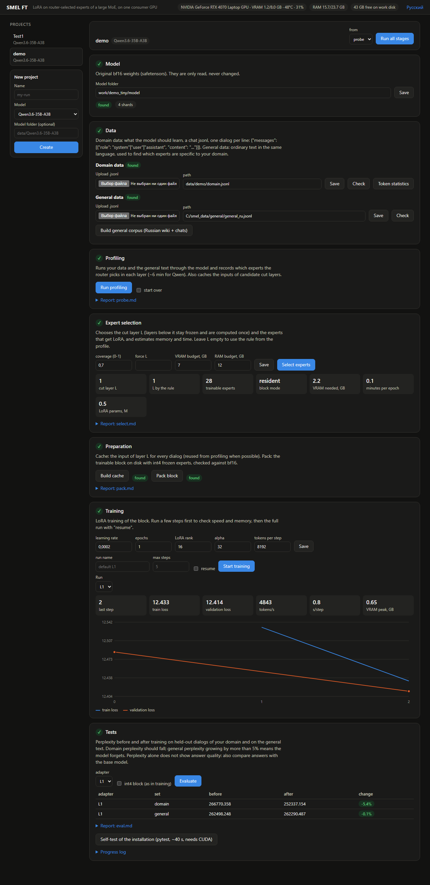

# SMEL FT — Sparse MoE LoRA Fine-Tuning

[Русская версия](README.ru.md)

Fine-tune a 26-35B Mixture-of-Experts model on **one 8 GB consumer GPU**: LoRA only on the experts that the router
actually uses for your domain, with the frozen bottom of the network computed once and cached.

Tested end to end on two different MoE families, on an RTX 4070 Laptop (8 GB) with 24 GB RAM under Windows 11:

| model | trained block | 3 epochs | peak VRAM | held-out domain perplexity | persona breaks | details |
|---|---|---|---|---|---|---|
| **Qwen3.6-35B-A3B** | layers 16-39 / 20-39 | 18-27 min | 4.6-4.8 GB | 17.9 -> 8.0-8.3 | 20% -> 0-2% | [docs/results_qwen.md](docs/results_qwen.md) |
| **Gemma 4 26B A4B** | layers 12-29 | 21-22 min | 5.5 GB | 128 -> 8.6 | 20% -> 6-8% | [docs/results_gemma4.md](docs/results_gemma4.md) |

Both runs end with a GGUF of the same size and speed as the original quant, and neither shows forgetting on
general text. The task in both was a persona fine-tune on 1000 Russian chat dialogs (61k supervised tokens).

## Why

- In transformers 5.x and in the checkpoints, the experts of Qwen3.5/3.6-MoE and Gemma 4 are **fused 3D tensors**
  (e.g. `gate_up_proj [256, 1024, 2048]` per Qwen layer). PEFT cannot put LoRA on a single expert, and
  bitsandbytes does not quantize these tensors.
- 4-bit QLoRA is not recommended for these families, and LoRA through the usual tools needs the whole model on the
  GPU (Unsloth lists > 40 GB of VRAM for Gemma 4 26B A4B).
- In a MoE layer, a domain mostly uses a small subset of experts, so training only those is cheap.

## How it works

```
probe    run all layers once, layer by layer, over domain and general text; record the router distribution
select   D_l = KL(p_domain || p_general) per layer -> cut layer L; per layer the smallest expert set that covers
         p = 50% of the domain gate mass (<= k_max = 12); budget estimate for VRAM / RAM / time
cache    hidden states entering layer L for the whole dataset (a free by-product of probe)
pack     block L..N-1: frozen experts -> int4 (group 64), selected experts and dense parts -> bf16, lm_head -> int8
train    LoRA on the selected experts + the always-active MLP of every block layer (Qwen: shared expert,
         Gemma 4: dense MLP), router frozen; layer-major schedule: each layer is loaded to the GPU twice per
         optimizer step (forward for all micro-batches, then backward with recompute)
merge    LoRA merged exactly into the bf16 weights (unchanged shards are hard-linked)
export   GGUF: a copy of an existing quant of the base model in which only the trained tensors are re-quantized,
         with the same ggml type and importance matrix; all other bytes stay identical
```

The rest of the implementation:
- **Own MoE forward.** Frozen experts run in a custom autograd function that dequantizes weights again, group by
  group, in backward, so a layer of experts is never held for autograd. Per-expert matmuls use `torch._grouped_mm`;
  int4 dequantization is a Triton kernel. The combine step is deterministic (no atomics).
- **Layers.** Qwen: Gated DeltaNet on flash-linear-attention kernels and gated full attention. Gemma 4:
  sliding-window and global attention (K = V, partial proportional RoPE, head_dim 512 via memory-efficient SDPA),
  dense MLP in parallel with the experts. Sequence packing works through `cu_seqlens`, a boundary-aware causal conv
  and block-diagonal / windowed masks, all checked by tests.
- **Loss.** Chunked cross-entropy over the 248-262k vocabulary without materializing logits, with Gemma's logit
  softcapping. One pass over the head weight: the gradient is accumulated online with the same running maximum as
  the log-sum-exp (35% less time than two passes at the Qwen vocabulary). Only the assistant answers are supervised; the training text matches the generation prompt with
  thinking off byte for byte.
- **Checkpoint access.** Tensors (or single expert rows) are read with plain file reads, never by mapping a whole
  shard: on Windows a 50 GB shard does not fit the commit limit.
- **Fused kernels.** The norms of the frozen layers are Triton kernels, one launch each way: RMSNorm, the residual
  add fused with the norm after it, and the gated output norm of Gated DeltaNet (backward gives dx only, the norm
  weights are frozen; fp32 and CPU keep the torch code, which the exact gradient tests use). The LoRA add is the
  epilogue of its GEMM (`addmm`), and gate / up of an MLP share one base GEMM and one LoRA-A GEMM. On one Qwen3.6
  layer at full size (`scripts/bench/bench_layer.py`, 4092 tokens): forward −9…−10%, recompute + backward −8…−10%,
  activation peak up to −13% (Gated DeltaNet layers).
- **Weight streaming.** Double-buffered prefetch on a side CUDA stream, from pinned RAM or from disk.
- **Resumable stages.** Long stages can be continued with `--resume`, and every stage appends a summary to
  `logs/progress.md`.

## Supported models

Architectures of transformers; sizes are read from `config.json`.

| architecture | tested model | trained next to the selected experts | config |
|---|---|---|---|
| `qwen3_5_moe` (Qwen3.5/3.6 MoE) | `Qwen/Qwen3.6-35B-A3B` | shared expert | [configs/default.yaml](configs/default.yaml) |
| `gemma4` with a MoE block | `google/gemma-4-26B-A4B-it` | dense MLP | [configs/gemma4.yaml](configs/gemma4.yaml) |

Both paths are checked against transformers on tiny random models of the same class (`tests/`), and the Gemma 4
layers additionally on the real weights.

## Requirements

- An NVIDIA GPU with ~6 GB free VRAM (Ampere or newer: bf16 and Triton). Tested on an RTX 4070 Laptop, 8 GB.
- 24 GB RAM tested (the RAM budget is a config value; less was not tried).
- Disk: the bf16 weights (Qwen 72 GB, Gemma 52 GB) + ~15-25 GB for the cache and the packed block + the GGUF.
- Python 3.11+ (tested on 3.14), torch 2.11+ with CUDA, transformers 5.17+, Triton
  (`triton-windows` on Windows), flash-linear-attention (Qwen only). Linux and native Windows work; WSL is not needed.
- For GGUF export and evaluation: a [llama.cpp](https://github.com/ggml-org/llama.cpp) build (`llama-server`,
  `ggml-base`), plus an existing GGUF of the base model and its importance matrix.

```bash
pip install -e ".[gguf,data,dev]"      # install torch with CUDA first, from pytorch.org
python -m pytest                       # ~40 s; needs CUDA; downloads only the tokenizer files
```

## Quick start

```bash
# 0. data: your chat jsonl -> data/domain.jsonl, one dialog per line:
#    {"messages": [{"role": "system", ...}, {"role": "user", ...}, {"role": "assistant", ...}]}
python scripts/download.py                    # Qwen; for Gemma 4: --repo google/gemma-4-26B-A4B-it
python scripts/make_general.py                # reference text -> data/general.jsonl (Russian wiki + chats);
                                              # or put your own general text there
# for Gemma 4 add --config configs/gemma4.yaml to every command below

# optional dry run of the whole pipeline on a tiny random model of the same class (minutes):
python scripts/make_tiny_e2e.py --general data/general.jsonl          # --arch gemma4 for Gemma
#   ... then every stage below with --config configs/tiny_e2e.yaml (configs/tiny_e2e_gemma4.yaml)

python scripts/probe.py                       # router profile, ~6 min; reports/probe.md
python scripts/select_experts.py              # L + experts + memory/time estimate; configs/selection.yaml
#   to force a cut layer: --set select.L_override=16
python scripts/cache.py                       # input of layer L (hard-linked from the probe if available)
python scripts/pack.py                        # packed block + check against bf16 on 50 dialogs
python scripts/train.py --max-steps 5         # smoke test, then:
python scripts/train.py --resume --set train.lr=2e-4
python scripts/eval.py --adapter artifacts/adapter_L16
python scripts/merge.py --adapter artifacts/adapter_L16 --out work/merged_L16 --verify
SMEL_LLAMA_CPP_DIR=/path/to/llama.cpp/build/bin \
python scripts/export_gguf.py --adapter artifacts/adapter_L16 --base-gguf base.gguf --imatrix imatrix.gguf
```

All settings live in the config and can be overridden per run, e.g. `--set train.lr=2e-4 train.epochs=4`.

### Web UI

```bash
python ui/server.py            # open http://127.0.0.1:7860
```

A local page that runs the same pipeline without the command line: data upload and checks, choosing one of the two
models, profiling, expert selection, cache and pack, training and the perplexity test. It runs on the standard library
and listens on localhost only.



**How to use it**

1. **Create a project.** In the left column, enter a name, choose the model (Qwen3.6-35B-A3B or Gemma 4 26B-A4B) and
   optionally the folder with its weights, then press *Create*. Each project keeps its own settings and outputs.
2. **Model.** The page shows whether the weights are found. If not, *Download* fetches them from Hugging Face (with a
   confirmation and a check of free disk space). The weights are only read, never changed.
3. **Data.** Upload a chat `.jsonl` (one dialog per line: `{"messages": [...]}`) or type a path, then press *Check*.
   The check reports broken lines, duplicates, answer lengths and two common defects: very short answers and missing
   spaces after punctuation. Fix the errors before continuing; warnings are worth reading. *Token statistics* shows the
   token counts. For the general text, upload a file or press *Build general corpus*.
4. **Profiling** (about 6 minutes for Qwen). Records which experts the router picks for your data. Re-run with
   *start over* only if the data changed.
5. **Expert selection.** Shows the chosen cut layer L, the number of trainable experts and the estimated VRAM and time.
   Change coverage, force L or the memory budgets and press *Select experts* again if needed.
6. **Preparation.** *Build cache* and *Pack block* are needed once per cut layer.
7. **Training.** Set the learning rate, epochs, LoRA rank and alpha. Start with a short test run (*max steps*), check
   speed and memory, then run in full. *Resume* continues an interrupted run from its last checkpoint. The chart shows
   training and validation loss; hover over it for exact values. Each run is saved under its own name.
8. **Tests.** *Evaluate* measures perplexity before and after training on held-out domain dialogs and on the general
   text. Domain perplexity should go down; a rise above 5% on the general text means the model forgets. Perplexity does
   not show answer quality, so also compare answers with the base model. *Self-test* runs pytest to check the install.
9. **Run all stages** starts the pipeline from the stage chosen in *from* and stops at the first failure.

The bottom panel shows the running stage with its live log. *Stop* ends the current stage (the whole process tree).
Only one stage runs at a time, so the GPU is never shared between two jobs. Everything is also available from the
command line: the buttons run the scripts from the table below with the project's config,
`configs/projects/<name>.yaml`. Outputs go to `work/<name>`, `artifacts/<name>`, `reports/<name>` and `logs/<name>`.

The page can be switched between English and Russian (the button in the header). Use `--host 0.0.0.0` only on a trusted
network: it makes the page and the stages reachable from other computers, and there is no password.

### Chat window

The **Chat with a model** button in the header opens a separate window for talking to a GGUF model with this
project's inference settings (it needs a [llama.cpp](https://github.com/ggml-org/llama.cpp) build; GGUF export itself
stays on the command line, `scripts/export_gguf.py`).

1. **Model.** Pick the GGUF (the list shows the files in `work/<project>/gguf`, where the export writes, and in the
   folder set under *Advanced*) or type a path, and give the path of `llama-server` or of the build folder. GGUFs with
   mixed-precision experts need the patched build from [inference/](inference/README.md). *Save* keeps the settings in
   `configs/chat.local.yaml`; they apply at the next start.
2. **Start model**, or just send a message: a stopped model is started for you (20-60 s) and the answer follows.
3. **Chat.** Answers stream in. Under each one the window shows the first-token time, tokens per second, and how many
   prompt tokens were new and how many came from the prompt cache. *Stop* cuts a generation short. The system prompt,
   sampling presets (Qwen3.6, Gemma 4) and the *Thinking* switch are in *Chat settings*; the conversation is kept in
   the browser until you press *Clear chat*.

What the window applies (measured on the reference app, Qwen3.6-35B-A3B on an 8 GB GPU and 24 GB RAM, see
[docs/results_mixed_experts.md](docs/results_mixed_experts.md)):

| setting | default | effect |
|---|---|---|
| experts in RAM (`--n-cpu-moe 99`) | all | ~4.4 GB of VRAM, room for other GPU programs; experts on the GPU were not faster (22.6 vs 22.3 tok/s) |
| MTP draft tokens | auto: 1 for Qwen, off for Gemma | 22.8 tok/s against 21.1 without and 20.9 with 2; needs a GGUF with the MTP head |
| prompt cache, one slot | on | each turn computes only the new tokens |
| micro-batch 1024, q8_0 KV cache | on | long prompts ~1.7x faster than with 512; less VRAM for the context |
| sleep after idle | 15 min | unloads the model (RAM ~15 -> 0.5 GB) |
| warm-up | on | typing in the window wakes a sleeping model: the GGUF is read in order into the OS cache and a 1-token request puts the system prompt into the cache; the first answer after sleep took ~5 s instead of 20-50 s |
| `mlock` | off | pins the weights in RAM; needs free RAM of the model size |

Generation speed follows how much of the weights stays in RAM (29 tok/s with all 12 GB resident, 24 with 9 GB, 15 with
5 GB), so close memory-hungry programs before a long chat. The model and a pipeline stage do not fit in VRAM
together: starting one while the other runs is refused with a message.

## Project layout

```
smel/       library: model_io (checkpoint access, model dimensions), moe, quant (int4 + Triton dequant), lora,
            layer_runner (Qwen and Gemma 4 layers, layer-major runner), norm (Triton norms), stream (prefetch),
            loss (chunked CE),
            data (chat templates + masks + packing), bottom (layer-by-layer pass of the frozen layers),
            pack (packing + exact merge), gguf_patch, pipeline (config, stores), tiny (test models),
            mixed_experts (hot/cold expert GGUF)
scripts/    pipeline stages, expert_usage + mixed_experts_gguf (inference), scripts/bench/ benchmarks
configs/    default.yaml (Qwen), gemma4.yaml
ui/         web UI: server.py (standard library), index.html (pipeline), chat.html + chat_backend.py (chat window)
tests/      equivalence tests against transformers on tiny random models of both classes, mixed-experts GGUF layout
examples/   persona_eval: generation, automatic metrics, blind pairwise judges (reference answers; identical contexts)
inference/  mixed-precision experts: llama.cpp patch and how-to
docs/       results of the reference experiments
```

## License

[Apache-2.0](LICENSE). The llama.cpp patch in `inference/llama_cpp_patches/` modifies llama.cpp and is under its MIT
license. The base models, their weights and tokenizers are not included and keep their own licenses. See [NOTICE](NOTICE).
