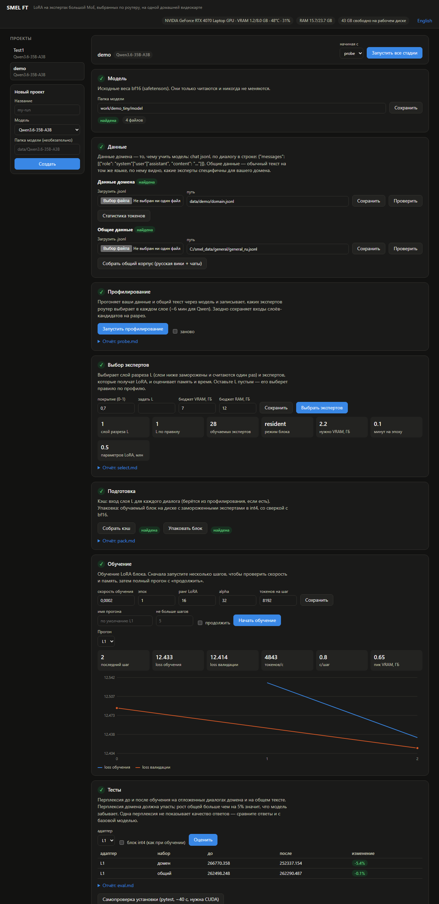

# SMEL FT — Sparse MoE LoRA Fine-Tuning

[English version](README.md)

Дообучение MoE-модели на 26–35B параметров на **одной потребительской видеокарте на 8 ГБ**. LoRA ставится только на
тех экспертов, которых роутер действительно выбирает на ваших данных, а замороженный низ сети считается один раз
и кэшируется.

Проверено от начала до конца на двух разных семействах MoE, на RTX 4070 Laptop (8 ГБ), 24 ГБ RAM, Windows 11:

| модель | обучаемый блок | 3 эпохи | пик видеопамяти | перплексия на отложенных данных | выход из роли | подробности |
|---|---|---|---|---|---|---|
| **Qwen3.6-35B-A3B** | слои 16–39 / 20–39 | 18–27 мин | 4,6–4,8 ГБ | 17,9 → 8,0–8,3 | 20% → 0–2% | [docs/results_qwen.md](docs/results_qwen.md) |
| **Gemma 4 26B A4B** | слои 12–29 | 21–22 мин | 5,5 ГБ | 128 → 8,6 | 20% → 6–8% | [docs/results_gemma4.md](docs/results_gemma4.md) |

Оба прогона заканчиваются GGUF того же размера и скорости, что исходный квант, и ни в одном нет «забывания» общего
текста. Задача в обоих — персонаж по 1000 русских чат-диалогов (61 тыс. токенов ответов). Отчёты в `docs/` на
английском.

## Зачем

- В transformers 5.x и в чекпойнтах эксперты Qwen3.5/3.6-MoE и Gemma 4 хранятся **слитыми 3D-тензорами**
  (например, `gate_up_proj [256, 1024, 2048]` на слой Qwen). PEFT не может повесить LoRA на отдельного эксперта,
  а bitsandbytes такие тензоры не квантует.
- 4-битный QLoRA для этих семейств не рекомендуется, а LoRA обычными инструментами требует всю модель в видеопамяти
  (Unsloth указывает больше 40 ГБ для Gemma 4 26B A4B).
- В MoE-слое домен в основном использует небольшую часть экспертов, поэтому обучать только их дёшево.

## Как это работает

```
probe    один проход всех слоёв, слой за слоем, по доменному и общему тексту; статистика роутера
select   D_l = KL(p_domain || p_general) по слоям -> точка разреза L; в каждом слое минимальный набор экспертов,
         покрывающий p = 50% доменной gate-массы (не больше k_max = 12); оценка VRAM / RAM / времени
cache    скрытые состояния на входе слоя L для всего датасета (бесплатный побочный продукт probe)
pack     блок L..N-1: замороженные эксперты -> int4 (группа 64), выбранные эксперты и плотные части -> bf16,
         lm_head -> int8
train    LoRA на выбранных экспертах + на MLP, который работает всегда (Qwen: shared-эксперт, Gemma 4: плотный
         MLP), роутер заморожен; порядок «слой за слоем»: каждый слой загружается в GPU дважды за шаг
         оптимизатора (forward по всем микробатчам, затем backward с recompute)
merge    точное вливание LoRA в bf16-веса (неизменённые шарды — жёсткие ссылки)
export   GGUF: копия существующего кванта базовой модели, в которой заново квантованы только обученные тензоры,
         с тем же типом ggml и той же imatrix; остальные байты не меняются
```

Подробнее о реализации:
- **Свой MoE-forward.** Замороженные эксперты считаются в своей autograd-функции: в backward веса деквантуются
  заново, группами, и целый слой экспертов для autograd не хранится. Матричные умножения по экспертам — через
  `torch._grouped_mm`, деквантизация int4 — Triton-ядро. Сборка выходов экспертов детерминированная (без атомарных
  операций).
- **Слои.** Qwen: Gated DeltaNet на ядрах flash-linear-attention и полное внимание с гейтом. Gemma 4: внимание
  с окном и глобальное (K = V, частичный «proportional» RoPE, head_dim 512 через memory-efficient SDPA), плотный MLP
  параллельно с экспертами. Упаковка последовательностей работает через `cu_seqlens`, causal conv с учётом границ
  и блочно-диагональные маски с окном; всё проверено тестами.
- **Лосс.** Чанкнутый cross-entropy по словарю из 248–262 тыс. токенов без материализации логитов, с softcapping
  логитов Gemma. Один проход по весу головы: градиент накапливается онлайн с тем же текущим максимумом, что и
  log-sum-exp (на словаре Qwen на 35% меньше времени, чем два прохода). Лосс считается только по ответам ассистента; обучающий текст побайтно совпадает с промптом
  генерации при выключенных рассуждениях.
- **Чтение чекпойнта.** Тензоры (и отдельные строки экспертов) читаются обычным чтением файла, без отображения
  шарда в память целиком: на Windows шард на 50 ГБ не помещается в лимит выделенной памяти.
- **Слитые ядра.** Нормы замороженных слоёв — Triton-ядра, по одному запуску в каждую сторону: RMSNorm, сложение
  с residual вместе со следующей за ним нормой и выходная норма Gated DeltaNet с гейтом (backward считает только dx,
  веса норм заморожены; fp32 и CPU остаются на torch-коде, по нему идут точные тесты градиентов). Сложение LoRA —
  эпилог её GEMM (`addmm`), gate и up одного MLP делят базовый GEMM и GEMM LoRA-A. На одном слое Qwen3.6 полного
  размера (`scripts/bench/bench_layer.py`, 4092 токена): forward −9…−10%, пересчёт + backward −8…−10%, пик
  активаций до −13% (слои Gated DeltaNet).
- **Подгрузка весов.** Двойной буфер с предзагрузкой в отдельном CUDA-стриме, из pinned RAM или с диска.
- **Продолжение прогонов.** Длинные этапы продолжаются с `--resume`, каждый этап дописывает краткий итог
  в `logs/progress.md`.

## Поддерживаемые модели

Архитектуры transformers; размеры берутся из `config.json`.

| архитектура | проверенная модель | что обучается рядом с выбранными экспертами | конфиг |
|---|---|---|---|
| `qwen3_5_moe` (Qwen3.5/3.6 MoE) | `Qwen/Qwen3.6-35B-A3B` | shared-эксперт | [configs/default.yaml](configs/default.yaml) |
| `gemma4` с MoE-блоком | `google/gemma-4-26B-A4B-it` | плотный MLP | [configs/gemma4.yaml](configs/gemma4.yaml) |

Оба пути сверяются с transformers на маленьких случайных моделях того же класса (`tests/`), слои Gemma 4 — ещё и на
настоящих весах.

## Требования

- Видеокарта NVIDIA с ~6 ГБ свободной видеопамяти (Ampere или новее: bf16 и Triton). Проверено на RTX 4070 Laptop,
  8 ГБ.
- Проверено на 24 ГБ RAM (бюджет RAM задаётся в конфиге, меньше не пробовали).
- Диск: bf16-веса (Qwen 72 ГБ, Gemma 52 ГБ) + ~15–25 ГБ на кэш и упакованный блок + GGUF.
- Python 3.11+ (проверено на 3.14), torch 2.11+ с CUDA, transformers 5.17+, Triton (`triton-windows` на Windows),
  flash-linear-attention (только для Qwen). Работает на Linux и на обычной Windows, WSL не нужен.
- Для экспорта GGUF и оценки: сборка [llama.cpp](https://github.com/ggml-org/llama.cpp) (`llama-server`,
  `ggml-base`), существующий GGUF базовой модели и его importance matrix.

```bash
pip install -e ".[gguf,data,dev]"      # сначала поставьте torch с CUDA с pytorch.org
python -m pytest                       # ~40 с; нужна CUDA; скачиваются только файлы токенайзеров
```

## Быстрый старт

```bash
# 0. данные: ваш chat jsonl -> data/domain.jsonl, по диалогу в строке:
#    {"messages": [{"role": "system", ...}, {"role": "user", ...}, {"role": "assistant", ...}]}
python scripts/download.py                    # Qwen; для Gemma 4: --repo google/gemma-4-26B-A4B-it
python scripts/make_general.py                # общий текст -> data/general.jsonl (русская Википедия + чаты);
                                              # или положите туда свой обычный текст
# для Gemma 4 добавьте --config configs/gemma4.yaml ко всем командам ниже

# по желанию: прогон всего конвейера на маленькой случайной модели того же класса (минуты):
python scripts/make_tiny_e2e.py --general data/general.jsonl          # --arch gemma4 для Gemma
#   ... и затем все этапы ниже с --config configs/tiny_e2e.yaml (configs/tiny_e2e_gemma4.yaml)

python scripts/probe.py                       # профиль роутера, ~6 мин; reports/probe.md
python scripts/select_experts.py              # L + эксперты + оценка памяти/времени; configs/selection.yaml
#   задать точку разреза вручную: --set select.L_override=16
python scripts/cache.py                       # вход слоя L (жёсткая ссылка на кэш из probe, если он есть)
python scripts/pack.py                        # упакованный блок + сверка с bf16 на 50 диалогах
python scripts/train.py --max-steps 5         # пробный запуск, затем:
python scripts/train.py --resume --set train.lr=2e-4
python scripts/eval.py --adapter artifacts/adapter_L16
python scripts/merge.py --adapter artifacts/adapter_L16 --out work/merged_L16 --verify
SMEL_LLAMA_CPP_DIR=/path/to/llama.cpp/build/bin \
python scripts/export_gguf.py --adapter artifacts/adapter_L16 --base-gguf base.gguf --imatrix imatrix.gguf
```

Все настройки — в конфиге; любую можно переопределить на один запуск, например `--set train.lr=2e-4 train.epochs=4`.

### Веб-интерфейс

```bash
python ui/server.py            # открыть http://127.0.0.1:7860
```

Локальная страница, которая делает то же, что конвейер, без командной строки: загрузка и проверка данных, выбор одной
из двух моделей, профилирование, выбор экспертов, кэш и упаковка, обучение и тест перплексии. Работает на стандартной
библиотеке и слушает только localhost.



**Как им пользоваться**

1. **Создайте проект.** В левой колонке введите название, выберите модель (Qwen3.6-35B-A3B или Gemma 4 26B-A4B), при
   желании укажите папку с весами и нажмите «Создать». У каждого проекта свои настройки и результаты.
2. **Модель.** Страница показывает, найдены ли веса. Если нет, «Скачать» загрузит их с Hugging Face (с подтверждением
   и проверкой свободного места). Веса только читаются, никогда не меняются.
3. **Данные.** Загрузите chat `.jsonl` (по диалогу в строке: `{"messages": [...]}`) или укажите путь, затем нажмите
   «Проверить». Проверка покажет битые строки, повторы, длину ответов и два частых дефекта: очень короткие ответы и
   отсутствие пробела после знаков препинания. Ошибки исправьте до продолжения; предупреждения стоит прочитать.
   «Статистика токенов» показывает число токенов. Для общего текста загрузите файл или нажмите «Собрать общий корпус».
4. **Профилирование** (около 6 минут для Qwen). Записывает, каких экспертов роутер выбирает на ваших данных.
   Повторяйте с «заново», только если данные изменились.
5. **Выбор экспертов.** Показывает выбранный слой разреза L, число обучаемых экспертов и оценку видеопамяти и времени.
   При необходимости поменяйте покрытие, задайте L или бюджеты памяти и снова нажмите «Выбрать экспертов».
6. **Подготовка.** «Собрать кэш» и «Упаковать блок» нужны один раз для каждого слоя L.
7. **Обучение.** Задайте скорость обучения, число эпох, ранг LoRA и alpha. Сначала запустите короткий пробный прогон
   («не больше шагов»), проверьте скорость и память, затем полный. «Продолжить» возобновляет прерванный прогон с
   последней контрольной точки. График показывает loss обучения и валидации; при наведении видны точные значения.
   Каждый прогон сохраняется под своим именем.
8. **Тесты.** «Оценить» измеряет перплексию до и после обучения на отложенных диалогах домена и на общем тексте.
   Перплексия домена должна падать; рост больше 5% на общем тексте означает, что модель забывает. Перплексия не
   показывает качество ответов, поэтому сравнивайте ответы и с базовой моделью. «Самопроверка» запускает pytest.
9. **«Запустить все стадии»** проходит конвейер, начиная со стадии из поля «начиная с», и останавливается на первой
   ошибке.

Нижняя панель показывает текущую стадию и её живой лог. «Остановить» завершает стадию (всё дерево процессов). Одновременно
идёт только одна стадия, поэтому видеокарта никогда не делится между двумя задачами. Всё доступно и из командной строки:
кнопки запускают скрипты из таблицы ниже с конфигом проекта `configs/projects/<имя>.yaml`. Результаты лежат в
`work/<имя>`, `artifacts/<имя>`, `reports/<имя>` и `logs/<имя>`.

Язык страницы переключается кнопкой в шапке. `--host 0.0.0.0` используйте только в доверенной сети: он делает страницу
и запуск стадий доступными с других компьютеров, а пароля нет.

### Окно чата

Кнопка **Чат с моделью** в шапке открывает отдельное окно для разговора с GGUF-моделью с настройками инференса
этого проекта (нужна сборка [llama.cpp](https://github.com/ggml-org/llama.cpp); сам экспорт в GGUF остаётся в командной
строке, `scripts/export_gguf.py`).

1. **Модель.** Выберите GGUF (в списке файлы из `work/<проект>/gguf`, куда пишет экспорт, и из папки, заданной в
   «Дополнительно») или впишите путь, и укажите путь к `llama-server` или к папке со сборкой. GGUF со смешанной точностью
   экспертов требует патченую сборку из [inference/](inference/README.md). «Сохранить» кладёт настройки в
   `configs/chat.local.yaml`; они вступают в силу при следующем запуске.
2. **Запустить модель** или просто отправьте сообщение: остановленная модель запустится сама (20-60 с), и придёт ответ.
3. **Чат.** Ответы идут потоком. Под каждым окно показывает время до первого токена, токены в секунду и сколько токенов
   промпта было новых, а сколько взято из кэша промпта. «Стоп» обрывает генерацию. Системный промпт, пресеты
   сэмплинга (Qwen3.6, Gemma 4) и переключатель «Рассуждение» — в «Настройках чата»; диалог хранится в браузере, пока
   вы не нажмёте «Очистить чат».

Что применяет окно (замеры на эталонном приложении, Qwen3.6-35B-A3B, видеокарта 8 ГБ и 24 ГБ RAM, см.
[docs/results_mixed_experts.md](docs/results_mixed_experts.md)):

| настройка | по умолчанию | эффект |
|---|---|---|
| эксперты в RAM (`--n-cpu-moe 99`) | все | ~4.4 ГБ видеопамяти, место остаётся другим программам; эксперты на GPU не быстрее (22.6 против 22.3 ток/с) |
| токены MTP-черновика | авто: 1 для Qwen, выкл. для Gemma | 22.8 ток/с против 21.1 без него и 20.9 с двумя; нужен GGUF с головой MTP |
| кэш промпта, один слот | вкл. | каждый ход считает только новые токены |
| микробатч 1024, KV-кэш q8_0 | вкл. | длинные промпты в ~1.7 раза быстрее, чем с 512; меньше видеопамяти на контекст |
| сон после простоя | 15 мин | выгружает модель (RAM ~15 -> 0.5 ГБ) |
| прогрев | вкл. | набор текста в окне будит спящую модель: GGUF читается подряд в кэш ОС, а запрос на 1 токен кладёт системный промпт в кэш; первый ответ после сна ~5 с вместо 20-50 с |
| `mlock` | выкл. | закрепляет веса в RAM; нужна свободная RAM размером с модель |

Скорость генерации зависит от того, сколько весов остаётся в RAM (29 ток/с при 12 ГБ в памяти, 24 при 9 ГБ, 15 при
5 ГБ), поэтому перед долгим чатом закройте программы, которым нужна память. Модель и стадия конвейера вместе в
видеопамять не помещаются: запуск одного при работающем другом отклоняется с сообщением.

## Структура проекта

```
smel/       библиотека: model_io (доступ к чекпойнту, размеры модели), moe, quant (int4 + Triton-деквант), lora,
            layer_runner (слои Qwen и Gemma 4, расписание «слой за слоем»), norm (Triton-нормы), stream (предзагрузка),
            loss (чанкнутый CE), data (шаблоны чата + маски + упаковка), bottom (послойный прогон замороженных
            слоёв), pack (упаковка + точное слияние), gguf_patch, pipeline (конфиг, хранилища), tiny (тестовые модели),
            mixed_experts (GGUF с горячими и холодными экспертами)
scripts/    этапы конвейера, expert_usage + mixed_experts_gguf (инференс), scripts/bench/ — бенчмарки
configs/    default.yaml (Qwen), gemma4.yaml
ui/         веб-интерфейс: server.py (стандартная библиотека), index.html (конвейер), chat.html + chat_backend.py (окно чата)
tests/      тесты эквивалентности с transformers на маленьких случайных моделях обоих классов, устройство смешанного GGUF
examples/   persona_eval: генерация, автометрики, слепые попарные судьи (по эталонным ответам; на одинаковых контекстах)
inference/  смешанная точность экспертов: патч llama.cpp и инструкция
docs/       результаты эталонных экспериментов
```

## Лицензия

[Apache-2.0](LICENSE). Патч в `inference/llama_cpp_patches/` изменяет llama.cpp и распространяется под её лицензией MIT.
Базовые модели, их веса и токенайзеры не входят в репозиторий и распространяются под своими лицензиями. См. [NOTICE](NOTICE).
