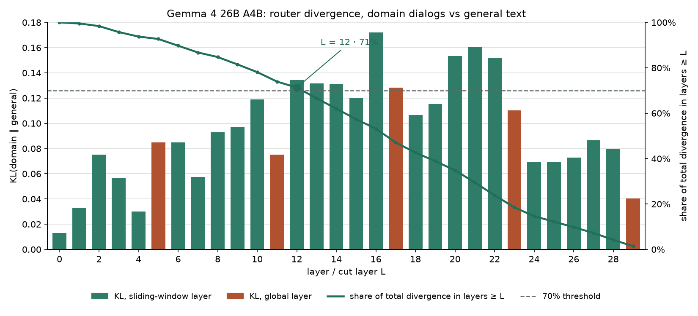

# Reference experiment 2: Gemma 4 26B A4B on the same laptop

The same task, data and machine as [experiment 1 (Qwen3.6-35B-A3B)](results_qwen.md): a persona fine-tune on
1000 private Russian chat dialogs (61k supervised tokens), RTX 4070 Laptop 8 GB, 24 GB RAM, Windows 11.
The point of this run was to check that SMEL FT carries over to a second, structurally different MoE family.

## Model

| | Gemma 4 26B A4B | Qwen3.6-35B-A3B |
|---|---|---|
| parameters, total / active | 26.5B / ~4B | 35B / ~3B |
| bf16 safetensors | 51.6 GB, **2 shards (one is 49.9 GB)** | 71.9 GB, 26 shards |
| layers | 30: 25 sliding-window (1024) + 5 global | 40: 30 Gated DeltaNet + 10 full attention |
| experts | 128, top-8, FFN 704, GELU-tanh | 256, top-8, FFN 512, SiLU |
| trained next to the experts | dense MLP 2112 in every layer, in parallel with the experts | shared expert 512 |
| global attention | head_dim 512, K = V, partial proportional RoPE | head_dim 256, gated |
| other | router with its own norm and per-expert scale, tied embeddings, logit softcapping 30 | |

## What had to change in SMEL

- **A second layer implementation** (`smel/layer_runner.py`): sliding/global attention with packing-aware masks,
  the dense MLP and the experts reading the residual through separate norms, the per-layer output scalar.
- **Router, activation, loss**: Gemma's router (`smel/moe.py`), GELU-tanh in the hand-written backward of the
  frozen experts, final-logit softcapping with its gradient in the chunked cross-entropy (`smel/loss.py`).
- **Checkpoint access** (`smel/model_io.py`): `safetensors.safe_open` maps a whole shard; on Windows the 49.9 GB
  shard exceeds the commit limit (RAM + pagefile) and the process dies with an access violation. SMEL now parses the
  safetensors header itself and reads only the bytes of the requested tensor (or expert rows), in 64 MB chunks.
- **Chat template** (`smel/data.py`): Gemma 4 starts the answer after an empty thought channel when thinking is off.
  Training inserts it before the last answer only, so every training sequence is byte-identical to the
  generation prompt llama-server builds.
- **Merge and GGUF export**: architecture-aware tensor names; the Unsloth GGUF keeps gate and up fused
  (`ffn_gate_up_exps`), the dense MLP is `ffn_gate/up/down`.

## Correctness

On a tiny random Gemma 4 of the same class (`tests/test_gemma4.py`, sliding window 16 so the masks matter):

| check | result |
|---|---|
| logits and loss vs `Gemma4ForCausalLM`, with and without sequence packing | rel. err < 1e-4 |
| LoRA grads (experts + dense MLP), layer-major backward vs plain autograd | 8e-6 / 3.5e-5 |
| frozen-experts GELU backward | < 1e-5 |
| softcapped chunked CE and its gradient | < 1e-4 |
| training prefix == generation prompt (thinking off) | byte-identical |

On the real weights: one sliding and one global layer vs `Gemma4TextDecoderLayer` on real cached hidden states
(645 tokens) — rel. err 3.7e-3 and 2.0e-3 (bf16 noise). The full 30-layer model through SMEL answers
"What is the capital of France?" with "Па(риж)" at probability ~1.0.

The GGUF path reproduces the Unsloth UD-Q3_K_XL file on an unchanged layer: the dense MLP (Q8_0) byte-identical,
the experts differ in 0.09% (IQ3_XXS) and 0.56% (IQ4_NL) of the bytes — the same picture as with Qwen.

## Router probe

All 30 layers in bf16, one layer in VRAM at a time: 388 s in total (64 s of it reading 45.6 GB of weights),
9.5 s per sliding-window layer, 12 s per global layer, peak VRAM 5.52 GB. Domain: 133.7k tokens, general:
199.7k tokens.

- Layers 0-4: almost no difference between domain and general text (KL 0.01-0.08).
- Layers 12-22: most of the domain specificity, peak at layer 16 (KL 0.172). Single experts are chosen up to
  15-94x more often on the domain than on general text.
- Layers 24-29: general again (KL 0.04-0.09, enrichment x1.0-1.5).
- Experts are more concentrated than in Qwen: 3-4 of 128 experts carry half of the domain gate mass in the top
  layers (Qwen: 9-12 of 256).
- The 70% coverage rule gives **L = 12**, same as for Qwen (12-13).

The same middle-layer picture in two different architectures is the main argument that the router profile finds
something real, not an artifact of one model.

## Training (L = 12)

| | |
|---|---|
| trained block | layers 12-29: 97 router-selected experts + 18 dense MLPs |
| LoRA parameters | 20.6 M (r = 16, alpha = 32) |
| packed block | 10.1 GB (frozen experts int4); int4 vs bf16 on 50 dialogs: perplexity +1.4% |
| run | 3 epochs, 45 steps of ~8k tokens, lr 2e-4: 21-22 min, ~25 s/step (7 s of it reading the block from disk) |
| peak VRAM / process RSS / GPU temperature | 5.52 GB / 2.7 GB / 69 °C |

Two runs: **G12** with the empty thought channel before every answer, **G12b** with it before the last answer
only (as at inference). G12b is the final one.

**Routing drift.** The router is frozen, but LoRA in the lower block layers changes what reaches it: in layers
16, 18 and 19 the share of domain gate mass on the selected experts fell by 23-35% during training (Qwen: at most
13%). On average over the block it went 0.44 -> 0.40. The experts were chosen on the model before training, so in
those layers part of the domain traffic moves to experts that are not trained.

## Results

Gemma 4 IT gives much sharper distributions than Qwen (probability ~1.0 on a confident answer, near zero on
anything off-style), so its absolute perplexities are far higher and are compared only before vs after.

| | domain perplexity, before -> after | general text, before -> after |
|---|---|---|
| G12 | 127.8 -> **8.6** | 52.9 -> 16.1 |
| G12b | 326.2 -> **9.1** (history answers no longer follow a thought channel, which raises the "before") | 52.9 -> 12.2 |

Answers to the same 50 held-out prompts (GGUF UD-Q3_K_XL through llama-server, same seed per prompt):

| | persona breaks ("as an AI") | `*stage directions*` | answer length, chars (reference 159) |
|---|---|---|---|
| Gemma before | 20% | 54% | 1061 |
| G12 | 8% | 4% | 315 |
| **G12b** | **6%** | **2%** | 335 |
| Qwen L20 (experiment 1) | 2% | 0% | 213 |

Blind pairwise judge (the base model; both orders; a win counts only when both orders agree):

| pair | wins | ties | p (sign test) |
|---|---|---|---|
| G12b vs Gemma before | 18 : 10 | 22 | 0.19 |
| G12 vs Gemma before | 19 : 13 | 18 | 0.38 |
| G12b vs G12 | 16 : 13 | 21 | 0.71 |
| Qwen L20 vs Qwen before (experiment 1) | 27 : 10 | 13 | 0.008 |

General questions (code, arithmetic, physics) are answered as well as before training.

## Conclusions

1. **SMEL FT works on Gemma 4 too:** the same pipeline, the same 8 GB laptop GPU, ~22 minutes for 3 epochs,
   peak VRAM 5.5 GB, a GGUF of the same size and speed as the original quant.
2. **The probe finds the same structure** as in Qwen: domain-specific routing in the middle layers, general routing
   at the top, and the same data-driven cut layer (L = 12).
3. **The training effect is clear on the automatic metrics** — persona breaks 20% -> 6%, stage directions
   54% -> 2%, answers 3x shorter — **but weaker than on Qwen**, and the judge's preference (18 : 10) is not
   statistically significant on 50 prompts.
4. **All remaining persona breaks (3 of 16) are in dialogs without a system prompt**, where Gemma falls back to
   its own identity ("I am Gemma 4, a large language model"). Its built-in identity is stronger than Qwen's;
   only 31% of the dataset has no system prompt.
5. **Routing drift is larger than in Qwen** (up to 35% in three layers). Re-selecting the experts on the
   partly trained model is a possible improvement.

Caveats: one domain, 50 prompts, one generation seed, the judge is the base model; perplexities of the two runs
are not comparable with each other (different rendering of history turns).

Possible next steps, not run: copies of the dialogs without the system prompt (data augmentation), more epochs,
re-selection of the experts after the first epoch, the same ablation as for Qwen (dense MLP only / random experts).
