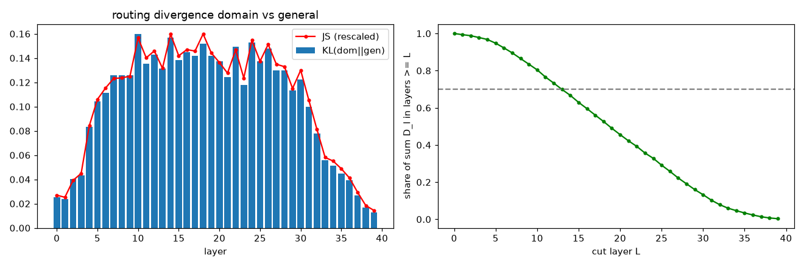

# Reference experiment 1: Qwen3.6-35B-A3B on a laptop

Everything below was run end to end with this repository on one machine. The task was a persona
fine-tune: a Russian-speaking character with a distinct voice (short, sarcastic answers in the first person,
never "as an AI..."). The dataset itself is private and not part of the repository.

## Setup

| | |
|---|---|
| GPU | RTX 4070 Laptop, 8 GB (6.9 GB free with the display on it), driver 591.66 |
| CPU / RAM | Ryzen 7 7435HS, 24 GB DDR5 (~12 GB free with a desktop session) |
| Disk | NVMe, ~1.3 GB/s sequential read |
| OS / stack | Windows 11 (native, no WSL), Python 3.14, torch 2.11+cu128, transformers 5.17, triton-windows 3.7.1, flash-linear-attention 0.5.2 |
| Base model | Qwen/Qwen3.6-35B-A3B, bf16 safetensors (71.9 GB) |
| Domain data | 1000 chat dialogs, 132k tokens, 61k supervised (assistant) tokens; 920 train / 30 val / 50 held out |
| General data | ~200k tokens: Russian Wikipedia + Russian assistant chats (`scripts/make_general.py`) |
| Hyper-parameters | LoRA r=16, alpha=32; AdamW lr 2e-4, cosine, 3 epochs = 45 steps x ~8k tokens; micro-batch 4k tokens |

## Correctness (tiny random model of the same class, `tests/`)

| check | result |
|---|---|
| own MoE forward vs `Qwen3_5MoeSparseMoeBlock` | fp32 < 1e-5, bf16 < 2e-2 |
| layer-major forward vs the full HF model | logits < 1e-3 (fp32), with and without sequence packing |
| LoRA grads, layer-major backward vs plain autograd | 3.5e-5 (4.9e-5 packed) with the exact torch DeltaNet; 2.5e-3 with FLA kernels (TF32 inside) |
| cached input of L + block vs the full model | bit-identical |
| merged weights vs base + LoRA | max abs diff 0 |
| interrupted bottom pass + `--resume` | bit-identical |

## Router probe

All 40 layers in bf16, one layer in VRAM at a time: ~9 s per layer, 32-60k tokens/s, peak VRAM 3.98 GB.
KL(domain || general) of the mean router distribution is small in layers 0-3 (0.02-0.04), high in 4-31
(0.08-0.16, peak in 10-28) and falls in 32-39. In the top layers the domain gate mass goes to the same experts
as general text (enrichment x1.0-1.5); in the middle layers to specific ones (x10-70). The 70% coverage rule
gives L = 12-13. Experts selected for L=20: `selection_L20_example.yaml`.

## Packing and training

| | L=20 | L=16 |
|---|---|---|
| trained block | layers 20-39 | layers 16-39 |
| trainable experts (+ shared) | 168 + 20 | 213 + 24 |
| LoRA parameters | 23.1 M | 29.1 M |
| packed block (int4 frozen experts, bf16 selected + dense) | 10.8 GB | ~13 GB |
| perplexity, bf16 block vs packed block (50 domain dialogs) | 17.88 vs 17.67 | 17.88 vs 17.55 |
| time per optimizer step (block streamed from disk) | ~21.5 s (7 s of it reading weights) | ~42 s |
| full run (3 epochs) | 18.4 min | 26.7 min |
| peak VRAM / process RSS | 4.56 GB / 2.3 GB | 4.75 GB / 2.3 GB |

The share of the domain gate mass routed to the selected experts stayed stable during training
(0.431 -> 0.423; the largest drop for one layer was 13%, the warning threshold is 20%).

## Ablation: does the router-based expert choice matter?

Every variant: same data, lr 2e-4, 3 epochs; the shared experts are trained in all of them. Only the set of
routed experts with LoRA differs.

| variant | routed experts with LoRA | domain gate mass on them |
|---|---|---|
| A: router-selected, L=20 | 168 (>= 50% of the layer's domain mass, <= 12 per layer) | 51.5% |
| B: random, L=20 | 168, same count per layer, random ids | 3% |
| C: shared experts only, L=20 | 0 | 0% |
| D: router-selected, L=16 | 213 | ~50% |

### Held-out perplexity (bf16 block = exactly the merged model)

Before fine-tuning: domain 17.88, general 3.252.

| variant | domain, per seed | mean | general text, change |
|---|---|---|---|
| A: router-selected, L=20 | 8.32 / 8.36 | **8.34** | +0.2% / -0.1% |
| B: random, L=20 | 8.86 / 8.91 | 8.88 | +0.4% / 0.0% |
| C: shared only, L=20 | 9.01 / 9.06 | 9.03 | +0.6% / +0.4% |
| D: router-selected, L=16 | 7.97 (1 seed) | **7.97** | +0.6% |

Seed-to-seed spread is ~0.05; the A-B gap (0.54) and B-C gap (0.15) hold on both seeds.

### Answers to 50 held-out prompts (GGUF UD-Q3_K_XL via llama-server, same seed per prompt)

| | persona breaks ("as an AI") | `*stage directions*` | answer length, chars (reference 159) |
|---|---|---|---|
| before | 20% | 56% | 1010 |
| A: router-selected, L=20 | **2%** | 0% | 213 |
| B: random, L=20 | 6% | 0% | 247 |
| C: shared only, L=20 | 8% | 0% | 249 |
| D: router-selected, L=16 | **0%** | 2% | 200 |

### Blind pairwise judge

The judge is the base model itself (temperature 0, thinking off). It sees the persona description, the dataset
reference answer, the question and two anonymous answers. Every pair is asked in both orders; a win counts only
when both orders agree. Code: `examples/persona_eval/`.

| pair | wins | ties | p (sign test) |
|---|---|---|---|
| A vs before | **27 : 10** | 13 | 0.008 |
| A vs C (shared only) | **30 : 8** | 12 | < 0.001 |
| A vs B (random) | 23 : 16 | 11 | 0.34 |
| B vs before | 23 : 15 | 12 | 0.26 |
| C vs before | 19 : 20 | 11 | 1.0 |
| D (L=16) vs A (L=20) | 19 : 18 | 13 | 1.0 |
| D (L=16) vs before | 24 : 19 | 7 | 0.54 |

## Conclusions

1. **The method works on an 8 GB laptop GPU:** a 35B MoE fine-tune in 20-30 minutes, peak VRAM < 5 GB, the result
   exported as a GGUF of the same size and speed as the original quant.
2. **Most of the effect comes from the shared experts.** On their own they halve the domain perplexity
   (17.88 -> 9.03) and remove the stage directions, but the judge does not prefer them over the base model.
3. **The router-based choice adds a real but moderate improvement:** -8% perplexity at L=20, -12% at L=16, while
   the same number of random experts gives -2%. The judge prefers it over every other variant; against random
   experts the margin (23:16) points the same way but is not significant on 50 prompts.
4. **A lower cut layer is better**, in line with the probe: L=16 beats L=20 on perplexity and persona breaks,
   at 1.4x the training time. The data-driven L (12-13) was not tested.
5. **No forgetting** was measured on general text in any variant (<= +0.6% perplexity).

Caveats: one domain, small evaluation (3k held-out tokens, 50 prompts, one generation seed), the judge is the
base model, and the variants were compared on the same held-out data used to pick the learning rate.
